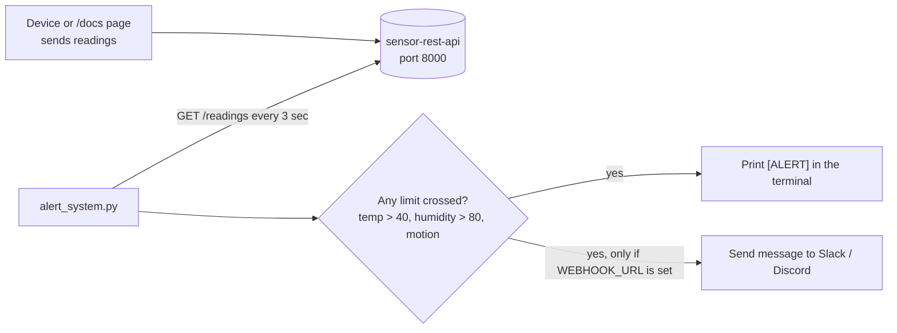

# IoT Alert System

A small program that keeps checking new sensor readings and prints an alert when something looks wrong: temperature too high, humidity too high, or motion detected. It reads the data from my `sensor-rest-api` project.

## What it does

Every 3 seconds it asks the API for the latest readings, checks only the new ones, and raises an alert if a limit is crossed.

| Check | Limit |
|---|---|
| High temperature | above 40 °C |
| High humidity | above 80 % |
| Motion | `motion_detected` is true |

One reading can trigger more than one alert.

## Block diagram



## How to run

1. Start the `sensor-rest-api` project first (inside its folder):
   ```
   uvicorn main:app --reload
   ```
2. In another terminal, in this folder:
   ```
   pip install -r requirements.txt
   python alert_system.py
   ```
3. Add a reading with a high temperature, for example 42, or with `motion_detected` as true. You can do this on http://127.0.0.1:8000/docs with POST `/readings`. An `[ALERT]` line should appear within a few seconds.

Optional: to also get alerts in Slack or Discord, set an environment variable called `WEBHOOK_URL` to your webhook link before running. If it is not set, alerts only print in the terminal.

## Built with

Python, requests

## What I learned

- **Polling.** The program asks the API again and again instead of the API telling it about new data. It is simple and works, but it is not instant, and it makes many requests.
- **No repeated alerts.** The API always sends the latest 20 readings, so the same reading would show up again and again. I remember the highest reading id already checked (`last_seen_id`) and skip anything older.
- **Alerts should not crash the program.** If the webhook is not reachable, it prints a message and keeps running.
- **Keeping parts separate.** `check_thresholds()` only decides if something is wrong, and `send_alert()` only sends the message. A new channel like email can be added without touching the checking code.

## Limits

- The limits are fixed in the code. A real product would let each device have its own limits.
- It does not remember anything after a restart, so it starts checking from the beginning again.
- It prints an alert for every reading that crosses a limit, so a long hot period gives many alerts.

## How my projects fit together

1. `iot-simulator-dashboard` makes fake readings and shows them live.
2. `sensor-rest-api` stores the readings in a database.
3. `iot-alert-system` (this project) watches the stored readings and raises alerts.
4. `sensor-anomaly-detection` learns what normal readings look like. It could later replace the fixed limits used here.

To send the simulator's readings to the API, change the URL in `publisher.py` to `http://127.0.0.1:8000/readings`.
